<picture><source media="(prefers-color-scheme: dark)" srcset="./assets/contributions-overview-header-dark.svg">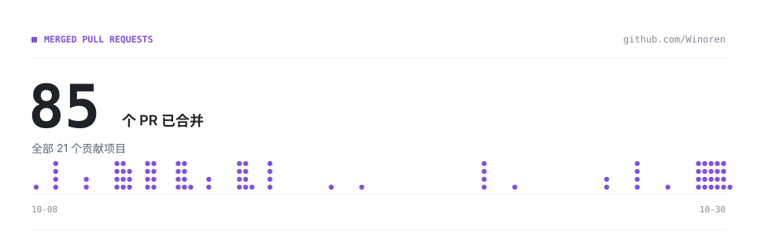</picture>

<a href="https://github.com/openclaw/openclaw" title="打开 openclaw/openclaw 项目仓库"><picture><source media="(prefers-color-scheme: dark)" srcset="./assets/overview-row-01-name-dark.svg"></picture></a><a href="https://github.com/Winoren/Winoren/blob/main/CONTRIBUTIONS.md#pr-openclaw-openclaw" title="查看 openclaw/openclaw 的 PR 明细"><picture><source media="(prefers-color-scheme: dark)" srcset="./assets/overview-row-01-count-dark.svg"></picture></a><picture><source media="(prefers-color-scheme: dark)" srcset="./assets/overview-row-01-stars-dark.svg"></picture>

<a href="https://github.com/langgenius/dify" title="打开 langgenius/dify 项目仓库"><picture><source media="(prefers-color-scheme: dark)" srcset="./assets/overview-row-02-name-dark.svg"></picture></a><a href="https://github.com/Winoren/Winoren/blob/main/CONTRIBUTIONS.md#pr-langgenius-dify" title="查看 langgenius/dify 的 PR 明细"><picture><source media="(prefers-color-scheme: dark)" srcset="./assets/overview-row-02-count-dark.svg"></picture></a><picture><source media="(prefers-color-scheme: dark)" srcset="./assets/overview-row-02-stars-dark.svg"></picture>

<a href="https://github.com/bytedance/deer-flow" title="打开 bytedance/deer-flow 项目仓库"><picture><source media="(prefers-color-scheme: dark)" srcset="./assets/overview-row-03-name-dark.svg"></picture></a><a href="https://github.com/Winoren/Winoren/blob/main/CONTRIBUTIONS.md#pr-bytedance-deer-flow" title="查看 bytedance/deer-flow 的 PR 明细"><picture><source media="(prefers-color-scheme: dark)" srcset="./assets/overview-row-03-count-dark.svg"></picture></a><picture><source media="(prefers-color-scheme: dark)" srcset="./assets/overview-row-03-stars-dark.svg"></picture>

<a href="https://github.com/BerriAI/litellm" title="打开 BerriAI/litellm 项目仓库"><picture><source media="(prefers-color-scheme: dark)" srcset="./assets/overview-row-04-name-dark.svg"></picture></a><a href="https://github.com/Winoren/Winoren/blob/main/CONTRIBUTIONS.md#pr-berriai-litellm" title="查看 BerriAI/litellm 的 PR 明细"><picture><source media="(prefers-color-scheme: dark)" srcset="./assets/overview-row-04-count-dark.svg"></picture></a><picture><source media="(prefers-color-scheme: dark)" srcset="./assets/overview-row-04-stars-dark.svg"></picture>

<a href="https://github.com/crewAIInc/crewAI" title="打开 crewAIInc/crewAI 项目仓库"><picture><source media="(prefers-color-scheme: dark)" srcset="./assets/overview-row-05-name-dark.svg"></picture></a><a href="https://github.com/Winoren/Winoren/blob/main/CONTRIBUTIONS.md#pr-crewaiinc-crewai" title="查看 crewAIInc/crewAI 的 PR 明细"><picture><source media="(prefers-color-scheme: dark)" srcset="./assets/overview-row-05-count-dark.svg"></picture></a><picture><source media="(prefers-color-scheme: dark)" srcset="./assets/overview-row-05-stars-dark.svg"></picture>

<a href="https://github.com/Tencent/WeKnora" title="打开 Tencent/WeKnora 项目仓库"><picture><source media="(prefers-color-scheme: dark)" srcset="./assets/overview-row-06-name-dark.svg"></picture></a><a href="https://github.com/Winoren/Winoren/blob/main/CONTRIBUTIONS.md#pr-tencent-weknora" title="查看 Tencent/WeKnora 的 PR 明细"><picture><source media="(prefers-color-scheme: dark)" srcset="./assets/overview-row-06-count-dark.svg"></picture></a><picture><source media="(prefers-color-scheme: dark)" srcset="./assets/overview-row-06-stars-dark.svg"></picture>

<a href="https://github.com/labring/FastGPT" title="打开 labring/FastGPT 项目仓库"><picture><source media="(prefers-color-scheme: dark)" srcset="./assets/overview-row-07-name-dark.svg"></picture></a><a href="https://github.com/Winoren/Winoren/blob/main/CONTRIBUTIONS.md#pr-labring-fastgpt" title="查看 labring/FastGPT 的 PR 明细"><picture><source media="(prefers-color-scheme: dark)" srcset="./assets/overview-row-07-count-dark.svg"></picture></a><picture><source media="(prefers-color-scheme: dark)" srcset="./assets/overview-row-07-stars-dark.svg"></picture>

<a href="https://github.com/microsoft/semantic-kernel" title="打开 microsoft/semantic-kernel 项目仓库"><picture><source media="(prefers-color-scheme: dark)" srcset="./assets/overview-row-08-name-dark.svg"></picture></a><a href="https://github.com/Winoren/Winoren/blob/main/CONTRIBUTIONS.md#pr-microsoft-semantic-kernel" title="查看 microsoft/semantic-kernel 的 PR 明细"><picture><source media="(prefers-color-scheme: dark)" srcset="./assets/overview-row-08-count-dark.svg"></picture></a><picture><source media="(prefers-color-scheme: dark)" srcset="./assets/overview-row-08-stars-dark.svg"></picture>

<a href="https://github.com/deepset-ai/haystack" title="打开 deepset-ai/haystack 项目仓库"><picture><source media="(prefers-color-scheme: dark)" srcset="./assets/overview-row-09-name-dark.svg"></picture></a><a href="https://github.com/Winoren/Winoren/blob/main/CONTRIBUTIONS.md#pr-deepset-ai-haystack" title="查看 deepset-ai/haystack 的 PR 明细"><picture><source media="(prefers-color-scheme: dark)" srcset="./assets/overview-row-09-count-dark.svg"></picture></a><picture><source media="(prefers-color-scheme: dark)" srcset="./assets/overview-row-09-stars-dark.svg"></picture>

<a href="https://github.com/1Panel-dev/MaxKB" title="打开 1Panel-dev/MaxKB 项目仓库"><picture><source media="(prefers-color-scheme: dark)" srcset="./assets/overview-row-10-name-dark.svg"></picture></a><a href="https://github.com/Winoren/Winoren/blob/main/CONTRIBUTIONS.md#pr-1panel-dev-maxkb" title="查看 1Panel-dev/MaxKB 的 PR 明细"><picture><source media="(prefers-color-scheme: dark)" srcset="./assets/overview-row-10-count-dark.svg"></picture></a><picture><source media="(prefers-color-scheme: dark)" srcset="./assets/overview-row-10-stars-dark.svg"></picture>

<a href="https://github.com/HKUDS/DeepCode" title="打开 HKUDS/DeepCode 项目仓库"><picture><source media="(prefers-color-scheme: dark)" srcset="./assets/overview-row-11-name-dark.svg"></picture></a><a href="https://github.com/Winoren/Winoren/blob/main/CONTRIBUTIONS.md#pr-hkuds-deepcode" title="查看 HKUDS/DeepCode 的 PR 明细"><picture><source media="(prefers-color-scheme: dark)" srcset="./assets/overview-row-11-count-dark.svg"></picture></a><picture><source media="(prefers-color-scheme: dark)" srcset="./assets/overview-row-11-stars-dark.svg"></picture>

<a href="https://github.com/neuml/txtai" title="打开 neuml/txtai 项目仓库"><picture><source media="(prefers-color-scheme: dark)" srcset="./assets/overview-row-12-name-dark.svg"></picture></a><a href="https://github.com/Winoren/Winoren/blob/main/CONTRIBUTIONS.md#pr-neuml-txtai" title="查看 neuml/txtai 的 PR 明细"><picture><source media="(prefers-color-scheme: dark)" srcset="./assets/overview-row-12-count-dark.svg"></picture></a><picture><source media="(prefers-color-scheme: dark)" srcset="./assets/overview-row-12-stars-dark.svg"></picture>

<a href="https://github.com/MervinPraison/PraisonAI" title="打开 MervinPraison/PraisonAI 项目仓库"><picture><source media="(prefers-color-scheme: dark)" srcset="./assets/overview-row-13-name-dark.svg"></picture></a><a href="https://github.com/Winoren/Winoren/blob/main/CONTRIBUTIONS.md#pr-mervinpraison-praisonai" title="查看 MervinPraison/PraisonAI 的 PR 明细"><picture><source media="(prefers-color-scheme: dark)" srcset="./assets/overview-row-13-count-dark.svg"></picture></a><picture><source media="(prefers-color-scheme: dark)" srcset="./assets/overview-row-13-stars-dark.svg"></picture>

<a href="https://github.com/gpustack/gpustack" title="打开 gpustack/gpustack 项目仓库"><picture><source media="(prefers-color-scheme: dark)" srcset="./assets/overview-row-14-name-dark.svg"></picture></a><a href="https://github.com/Winoren/Winoren/blob/main/CONTRIBUTIONS.md#pr-gpustack-gpustack" title="查看 gpustack/gpustack 的 PR 明细"><picture><source media="(prefers-color-scheme: dark)" srcset="./assets/overview-row-14-count-dark.svg"></picture></a><picture><source media="(prefers-color-scheme: dark)" srcset="./assets/overview-row-14-stars-dark.svg"></picture>

<a href="https://github.com/ApodexAI/FrontierAgent" title="打开 ApodexAI/FrontierAgent 项目仓库"><picture><source media="(prefers-color-scheme: dark)" srcset="./assets/overview-row-15-name-dark.svg"></picture></a><a href="https://github.com/Winoren/Winoren/blob/main/CONTRIBUTIONS.md#pr-apodexai-frontieragent" title="查看 ApodexAI/FrontierAgent 的 PR 明细"><picture><source media="(prefers-color-scheme: dark)" srcset="./assets/overview-row-15-count-dark.svg"></picture></a><picture><source media="(prefers-color-scheme: dark)" srcset="./assets/overview-row-15-stars-dark.svg"></picture>

<a href="https://github.com/crmne/ruby_llm" title="打开 crmne/ruby_llm 项目仓库"><picture><source media="(prefers-color-scheme: dark)" srcset="./assets/overview-row-16-name-dark.svg"></picture></a><a href="https://github.com/Winoren/Winoren/blob/main/CONTRIBUTIONS.md#pr-crmne-ruby-llm" title="查看 crmne/ruby_llm 的 PR 明细"><picture><source media="(prefers-color-scheme: dark)" srcset="./assets/overview-row-16-count-dark.svg"></picture></a><picture><source media="(prefers-color-scheme: dark)" srcset="./assets/overview-row-16-stars-dark.svg"></picture>

<a href="https://github.com/langroid/langroid" title="打开 langroid/langroid 项目仓库"><picture><source media="(prefers-color-scheme: dark)" srcset="./assets/overview-row-17-name-dark.svg"></picture></a><a href="https://github.com/Winoren/Winoren/blob/main/CONTRIBUTIONS.md#pr-langroid-langroid" title="查看 langroid/langroid 的 PR 明细"><picture><source media="(prefers-color-scheme: dark)" srcset="./assets/overview-row-17-count-dark.svg"></picture></a><picture><source media="(prefers-color-scheme: dark)" srcset="./assets/overview-row-17-stars-dark.svg"></picture>

<a href="https://github.com/modelscope/evalscope" title="打开 modelscope/evalscope 项目仓库"><picture><source media="(prefers-color-scheme: dark)" srcset="./assets/overview-row-18-name-dark.svg"></picture></a><a href="https://github.com/Winoren/Winoren/blob/main/CONTRIBUTIONS.md#pr-modelscope-evalscope" title="查看 modelscope/evalscope 的 PR 明细"><picture><source media="(prefers-color-scheme: dark)" srcset="./assets/overview-row-18-count-dark.svg"></picture></a><picture><source media="(prefers-color-scheme: dark)" srcset="./assets/overview-row-18-stars-dark.svg"></picture>

<a href="https://github.com/i-am-bee/beeai-framework" title="打开 i-am-bee/beeai-framework 项目仓库"><picture><source media="(prefers-color-scheme: dark)" srcset="./assets/overview-row-19-name-dark.svg"></picture></a><a href="https://github.com/Winoren/Winoren/blob/main/CONTRIBUTIONS.md#pr-i-am-bee-beeai-framework" title="查看 i-am-bee/beeai-framework 的 PR 明细"><picture><source media="(prefers-color-scheme: dark)" srcset="./assets/overview-row-19-count-dark.svg"></picture></a><picture><source media="(prefers-color-scheme: dark)" srcset="./assets/overview-row-19-stars-dark.svg"></picture>

<a href="https://github.com/NVIDIA/NeMo-Agent-Toolkit" title="打开 NVIDIA/NeMo-Agent-Toolkit 项目仓库"><picture><source media="(prefers-color-scheme: dark)" srcset="./assets/overview-row-20-name-dark.svg"></picture></a><a href="https://github.com/Winoren/Winoren/blob/main/CONTRIBUTIONS.md#pr-nvidia-nemo-agent-toolkit" title="查看 NVIDIA/NeMo-Agent-Toolkit 的 PR 明细"><picture><source media="(prefers-color-scheme: dark)" srcset="./assets/overview-row-20-count-dark.svg"></picture></a><picture><source media="(prefers-color-scheme: dark)" srcset="./assets/overview-row-20-stars-dark.svg"></picture>

<a href="https://github.com/ant-research/AntOmniEvo" title="打开 ant-research/AntOmniEvo 项目仓库"><picture><source media="(prefers-color-scheme: dark)" srcset="./assets/overview-row-21-name-dark.svg"></picture></a><a href="https://github.com/Winoren/Winoren/blob/main/CONTRIBUTIONS.md#pr-ant-research-antomnievo" title="查看 ant-research/AntOmniEvo 的 PR 明细"><picture><source media="(prefers-color-scheme: dark)" srcset="./assets/overview-row-21-count-dark.svg"></picture></a><picture><source media="(prefers-color-scheme: dark)" srcset="./assets/overview-row-21-stars-dark.svg"></picture>

<picture>
  <source media="(prefers-color-scheme: dark)" srcset="./assets/contributions-detail-dark.svg">
  
</picture>

<picture>
  <source media="(prefers-color-scheme: dark)" srcset="./assets/contribution-project-01-dark.svg">
  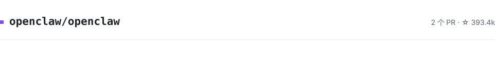
</picture>

> **[#173387](https://github.com/openclaw/openclaw/pull/173387)**
>
> fix(agents): contain failures publishing saved transcript updates
>
> ↳ Adopted by maintainer, rewritten and merged in [#174947](https://github.com/openclaw/openclaw/pull/174947) — commit [`4513e9e`](https://github.com/openclaw/openclaw/commit/4513e9e09633a740f58b4ccf8802597968868c47) credits me as co-author

> **[#173163](https://github.com/openclaw/openclaw/pull/173163)**
>
> fix(cron): preserve failure alerts refused before delivery
>
> ↳ Adopted by maintainer, rewritten and merged in [#173347](https://github.com/openclaw/openclaw/pull/173347) — commit [`ef97167`](https://github.com/openclaw/openclaw/commit/ef97167c3723c2bab32e7c703a9db99894946138) credits me as co-author

<picture>
  <source media="(prefers-color-scheme: dark)" srcset="./assets/contribution-project-02-dark.svg">
  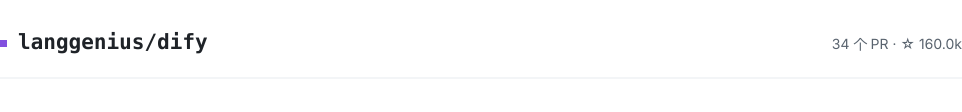
</picture>

> **[#44993](https://github.com/langgenius/dify/pull/44993)**
>
> test(agent): verify package icon imports with SQLite

> **[#44986](https://github.com/langgenius/dify/pull/44986)**
>
> test(agent): persist classic tool log ownership fixtures

> **[#44981](https://github.com/langgenius/dify/pull/44981)**
>
> test(tools): exercise MCP provider lookups with SQLite

> **[#44980](https://github.com/langgenius/dify/pull/44980)**
>
> test(knowledge): persist query image fixtures in SQLite

> **[#44953](https://github.com/langgenius/dify/pull/44953)**
>
> fix(rag): preserve already-decoded EML text

> **[#44905](https://github.com/langgenius/dify/pull/44905)**
>
> fix(rag): identify DOCX images by relationship type

> **[#44903](https://github.com/langgenius/dify/pull/44903)**
>
> fix(api): reject conflicting multipart file shapes

> **[#44893](https://github.com/langgenius/dify/pull/44893)**
>
> fix(rag): surface Notion database HTTP errors

> **[#44838](https://github.com/langgenius/dify/pull/44838)**
>
> fix(web): keep plugin settings open while saving

> **[#44830](https://github.com/langgenius/dify/pull/44830)**
>
> fix(web): keep metadata deletion open on failure

> **[#44788](https://github.com/langgenius/dify/pull/44788)**
>
> fix(web): guard external API deletion while pending

> **[#44715](https://github.com/langgenius/dify/pull/44715)**
>
> fix(web): keep dataset rename open while saving

> **[#44679](https://github.com/langgenius/dify/pull/44679)**
>
> fix(nodejs-client): allow long knowledge document text

> **[#44677](https://github.com/langgenius/dify/pull/44677)**
>
> fix(files): normalize remote file Content-Type media types

> **[#44675](https://github.com/langgenius/dify/pull/44675)**
>
> fix(php-sdk): encode empty app inputs as JSON objects

> **[#44659](https://github.com/langgenius/dify/pull/44659)**
>
> fix(php-sdk): use last_id for conversation pagination

> **[#44652](https://github.com/langgenius/dify/pull/44652)**
>
> fix(web): scope empty dataset creation to its dialog session

> **[#44648](https://github.com/langgenius/dify/pull/44648)**
>
> docs: sync Japanese README observability and help links

> **[#44644](https://github.com/langgenius/dify/pull/44644)**
>
> fix(web-api): reject internal approval tokens on public HITL endpoints

> **[#44620](https://github.com/langgenius/dify/pull/44620)**
>
> fix(web): update every Human Input variable block on workflow changes

> **[#44569](https://github.com/langgenius/dify/pull/44569)**
>
> fix(php-sdk): preserve custom API base URL paths

> **[#44280](https://github.com/langgenius/dify/pull/44280)**
>
> fix(import): preserve GitHub blob URL path components

> **[#44273](https://github.com/langgenius/dify/pull/44273)**
>
> fix(files): apply media limits to remote upload preflight

> **[#44271](https://github.com/langgenius/dify/pull/44271)**
>
> fix(php-sdk): avoid buffering streaming responses

> **[#44265](https://github.com/langgenius/dify/pull/44265)**
>
> fix(nodejs-client): accept empty pagination cursors

> **[#44263](https://github.com/langgenius/dify/pull/44263)**
>
> fix(nodejs-client): handle SSE line endings and leading BOMs

> **[#44120](https://github.com/langgenius/dify/pull/44120)**
>
> fix(nodejs-client): replace stale user fields in native upload forms

> **[#44097](https://github.com/langgenius/dify/pull/44097)**
>
> fix(nodejs-client): allow empty keyword filters in list APIs

> **[#44090](https://github.com/langgenius/dify/pull/44090)**
>
> fix(nodejs-client): override default headers case-insensitively

> **[#44085](https://github.com/langgenius/dify/pull/44085)**
>
> fix(dify-agent): treat a confirmed-missing Home Snapshot as a success on Enterprise delete

> **[#44084](https://github.com/langgenius/dify/pull/44084)**
>
> fix(api): stage hit-testing query log with flush instead of committing caller session

> **[#44083](https://github.com/langgenius/dify/pull/44083)**
>
> fix(nodejs-client): preserve SSE field value whitespace

> **[#44017](https://github.com/langgenius/dify/pull/44017)**
>
> fix(knowledge): only batch-enable segments whose indexing completed

> **[#44014](https://github.com/langgenius/dify/pull/44014)**
>
> fix(dify-agent): verify E2B binding Home as well as Workspace on acquire

<picture>
  <source media="(prefers-color-scheme: dark)" srcset="./assets/contribution-project-03-dark.svg">
  
</picture>

> **[#7642](https://github.com/bytedance/deer-flow/pull/7642)**
>
> fix(uploads): resolve conversion settings in the parser worker

> **[#7049](https://github.com/bytedance/deer-flow/pull/7049)**
>
> fix(skills): parse optimizer metadata as YAML

> **[#7043](https://github.com/bytedance/deer-flow/pull/7043)**
>
> fix(skills): drain completed trigger evaluator output

> **[#7011](https://github.com/bytedance/deer-flow/pull/7011)**
>
> docs(docker): document the locked PyPI index requirement

> **[#6966](https://github.com/bytedance/deer-flow/pull/6966)**
>
> refactor(community): fold serper onto the shared max_results owner

> **[#6779](https://github.com/bytedance/deer-flow/pull/6779)**
>
> fix(serper): report a format error for results with no usable objects

> **[#6719](https://github.com/bytedance/deer-flow/pull/6719)**
>
> fix(sofya): report a format error for a results list with no usable objects

<picture>
  <source media="(prefers-color-scheme: dark)" srcset="./assets/contribution-project-04-dark.svg">
  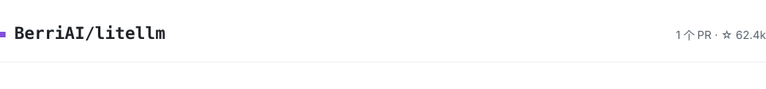
</picture>

> **[#44800](https://github.com/BerriAI/litellm/pull/44800)**
>
> fix(anthropic): let /v1/messages mid-stream failures reach the proxy failure boundary

<picture>
  <source media="(prefers-color-scheme: dark)" srcset="./assets/contribution-project-05-dark.svg">
  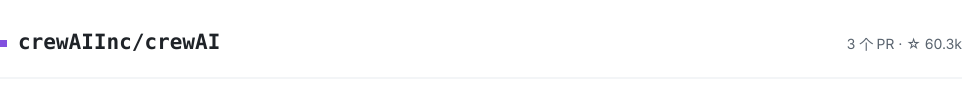
</picture>

> **[#8173](https://github.com/crewAIInc/crewAI/pull/8173)**
>
> fix(logging): preserve JSON logs on serialization errors

> **[#8171](https://github.com/crewAIInc/crewAI/pull/8171)**
>
> fix(usage): count dictionary usage in token callbacks

> **[#8169](https://github.com/crewAIInc/crewAI/pull/8169)**
>
> fix(skills): skip non-UTF-8 cached skill metadata

<picture>
  <source media="(prefers-color-scheme: dark)" srcset="./assets/contribution-project-06-dark.svg">
  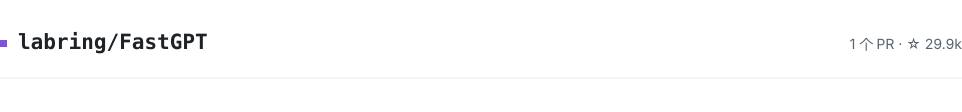
</picture>

> **[#7924](https://github.com/labring/FastGPT/pull/7924)**
>
> fix(workflow): handle non-string values in the string-inclusion evaluator

<picture>
  <source media="(prefers-color-scheme: dark)" srcset="./assets/contribution-project-07-dark.svg">
  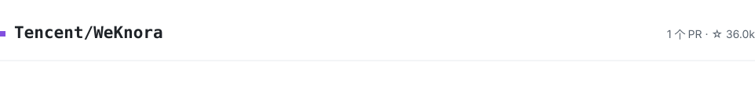
</picture>

> **[#3996](https://github.com/Tencent/WeKnora/pull/3996)**
>
> fix(repository): SearchUsers 兼容 SQLite 方言并转义 LIKE 通配符

<picture>
  <source media="(prefers-color-scheme: dark)" srcset="./assets/contribution-project-08-dark.svg">
  
</picture>

> **[#14563](https://github.com/microsoft/semantic-kernel/pull/14563)**
>
> fix(python): reject dot-segment remote paths in SessionsPythonTool.upload_file

<picture>
  <source media="(prefers-color-scheme: dark)" srcset="./assets/contribution-project-09-dark.svg">
  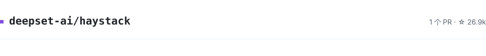
</picture>

> **[#13206](https://github.com/deepset-ai/haystack/pull/13206)**
>
> fix: support container metadata in document evaluators

<picture>
  <source media="(prefers-color-scheme: dark)" srcset="./assets/contribution-project-10-dark.svg">
  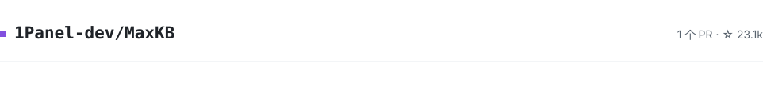
</picture>

> **[#7311](https://github.com/1Panel-dev/MaxKB/pull/7311)**
>
> fix: split at full-width exclamation/question marks in smart_split_paragraph

<picture>
  <source media="(prefers-color-scheme: dark)" srcset="./assets/contribution-project-11-dark.svg">
  
</picture>

> **[#256](https://github.com/HKUDS/DeepCode/pull/256)**
>
> fix(tools): prune _SKIP_DIRS below the glob base, not the whole path

> **[#255](https://github.com/HKUDS/DeepCode/pull/255)**
>
> fix(security): normalize the program path in the destructive-command screen

<picture>
  <source media="(prefers-color-scheme: dark)" srcset="./assets/contribution-project-12-dark.svg">
  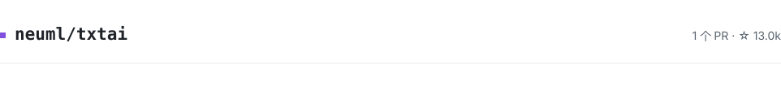
</picture>

> **[#1362](https://github.com/neuml/txtai/pull/1362)**
>
> Honor an empty allow list in the bash agent tool

<picture>
  <source media="(prefers-color-scheme: dark)" srcset="./assets/contribution-project-13-dark.svg">
  
</picture>

> **[#5732](https://github.com/MervinPraison/PraisonAI/pull/5732)**
>
> fix(memory): raise on unsupported URL scheme in array form instead of silently using the file backend

> **[#5731](https://github.com/MervinPraison/PraisonAI/pull/5731)**
>
> fix: normalise preset name lookup for array-form parameters

<picture>
  <source media="(prefers-color-scheme: dark)" srcset="./assets/contribution-project-14-dark.svg">
  
</picture>

> **[#6391](https://github.com/gpustack/gpustack/pull/6391)**
>
> fix(schemas): validate cache provider card icons

<picture>
  <source media="(prefers-color-scheme: dark)" srcset="./assets/contribution-project-15-dark.svg">
  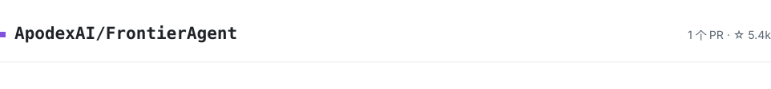
</picture>

> **[#66](https://github.com/ApodexAI/FrontierAgent/pull/66)**
>
> fix(agent-team): let gate ② track the configurable gate ① for bash / run_python_code

<picture>
  <source media="(prefers-color-scheme: dark)" srcset="./assets/contribution-project-16-dark.svg">
  
</picture>

> **[#1052](https://github.com/crmne/ruby_llm/pull/1052)**
>
> Check Mistral batch embedding row positions before pairing vectors with inputs

> **[#1051](https://github.com/crmne/ruby_llm/pull/1051)**
>
> Check embedding batch row positions before pairing vectors with inputs

<picture>
  <source media="(prefers-color-scheme: dark)" srcset="./assets/contribution-project-17-dark.svg">
  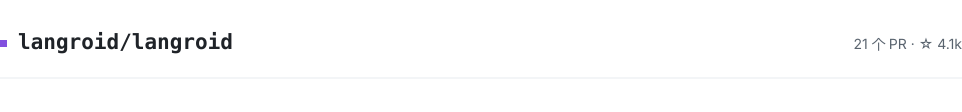
</picture>

> **[#1253](https://github.com/langroid/langroid/pull/1253)**
>
> fix(relevance_extractor_agent): send the extraction instructions in the async path too

> **[#1250](https://github.com/langroid/langroid/pull/1250)**
>
> fix(chat_agent): route the async strict-recovery retry through the async twin

> **[#1245](https://github.com/langroid/langroid/pull/1245)**
>
> fix(chat_agent): skip strict recovery in the async path when no tool is usable

> **[#1244](https://github.com/langroid/langroid/pull/1244)**
>
> fix(doc_chat_agent): return NO_ANSWER for an empty query in the async path

> **[#1243](https://github.com/langroid/langroid/pull/1243)**
>
> fix(openai_gpt): guard a null `choices` chunk in the async stream path

> **[#1242](https://github.com/langroid/langroid/pull/1242)**
>
> fix(repo_loader): report a failed clone as None, not as the target path

> **[#1241](https://github.com/langroid/langroid/pull/1241)**
>
> fix(pinecone): raise when add_documents fails instead of only logging

> **[#1238](https://github.com/langroid/langroid/pull/1238)**
>
> fix: allow special-token literals in Parser.truncate_tokens

> **[#1232](https://github.com/langroid/langroid/pull/1232)**
>
> fix: match literal types in Agent output extraction

> **[#1231](https://github.com/langroid/langroid/pull/1231)**
>
> fix: treat empty Redis key deletion as a no-op

> **[#1230](https://github.com/langroid/langroid/pull/1230)**
>
> fix: raise actionable errors for missing document backends

> **[#1229](https://github.com/langroid/langroid/pull/1229)**
>
> fix: retain numbered segment paragraph continuations

> **[#1228](https://github.com/langroid/langroid/pull/1228)**
>
> fix: preserve text across BPE chunk boundaries

> **[#1227](https://github.com/langroid/langroid/pull/1227)**
>
> fix: honor explicit embedding organization configuration

> **[#1226](https://github.com/langroid/langroid/pull/1226)**
>
> fix: deduplicate PDF split boundaries

> **[#1225](https://github.com/langroid/langroid/pull/1225)**
>
> fix: preserve whitespace in line-limited document reads

> **[#1223](https://github.com/langroid/langroid/pull/1223)**
>
> fix: preserve duplicate columns when loading tabular data

> **[#1221](https://github.com/langroid/langroid/pull/1221)**
>
> fix: honor zero overlap in Markdown chunking

> **[#1220](https://github.com/langroid/langroid/pull/1220)**
>
> fix: preserve Markdown hierarchy when heading levels are skipped

> **[#1218](https://github.com/langroid/langroid/pull/1218)**
>
> fix: handle UTF-8 BOMs when loading tabular data

> **[#1215](https://github.com/langroid/langroid/pull/1215)**
>
> fix(llm): handle content-filtered chunks in the async stream path

<picture>
  <source media="(prefers-color-scheme: dark)" srcset="./assets/contribution-project-18-dark.svg">
  
</picture>

> **[#1833](https://github.com/modelscope/evalscope/pull/1833)**
>
> fix(messages): absolutise local audio and video paths in markdown output

> **[#1832](https://github.com/modelscope/evalscope/pull/1832)**
>
> fix(multi-choice): accept a full-width comma between unbracketed answer labels

<picture>
  <source media="(prefers-color-scheme: dark)" srcset="./assets/contribution-project-19-dark.svg">
  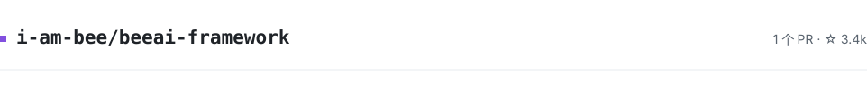
</picture>

> **[#1791](https://github.com/i-am-bee/beeai-framework/pull/1791)**
>
> fix(litellm): forward stop_sequences to the provider as stop

<picture>
  <source media="(prefers-color-scheme: dark)" srcset="./assets/contribution-project-20-dark.svg">
  
</picture>

> **[#2345](https://github.com/NVIDIA/NeMo-Agent-Toolkit/pull/2345)**
>
> fix(observability): resolve the OpenInference span kind from attribute context

<picture>
  <source media="(prefers-color-scheme: dark)" srcset="./assets/contribution-project-21-dark.svg">
  
</picture>

> **[#20](https://github.com/ant-research/AntOmniEvo/pull/20)**
>
> fix(proposer): detect degenerate Claude Code sessions before rollout
