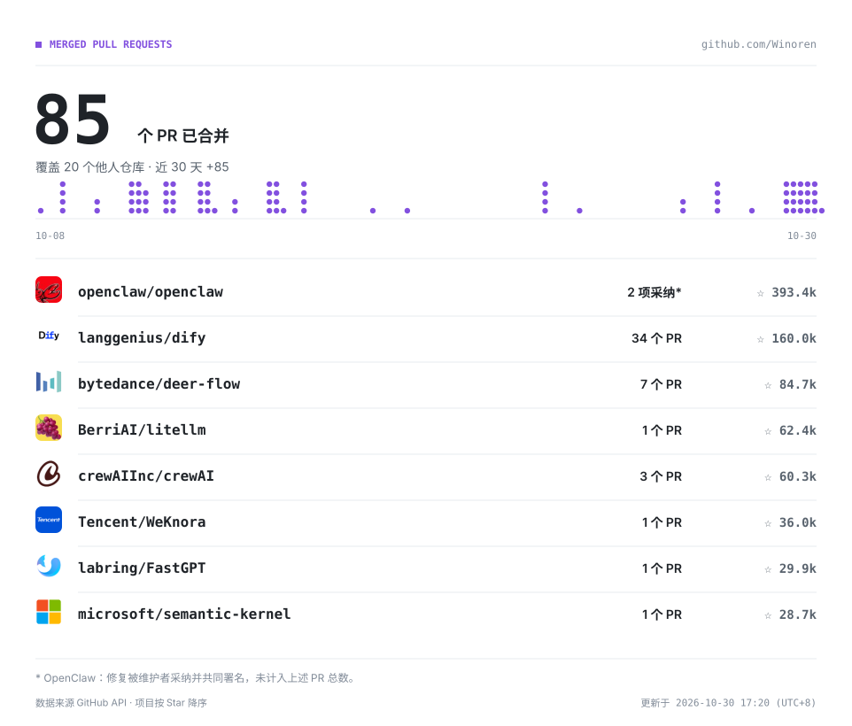

<picture>
  <source media="(prefers-color-scheme: dark)" srcset="./assets/hero-dark.svg">
  
</picture>

<a href="./CONTRIBUTIONS.md">
  <picture>
    <source media="(prefers-color-scheme: dark)" srcset="./assets/merged-prs-dark.svg">
    
  </picture>
</a>

[查看贡献明细](./CONTRIBUTIONS.md) · [查看已合并 PR](https://github.com/pulls?q=is%3Apr+author%3AWinoren+is%3Amerged) · [邮件联系](mailto:d2572973337@qq.com)
