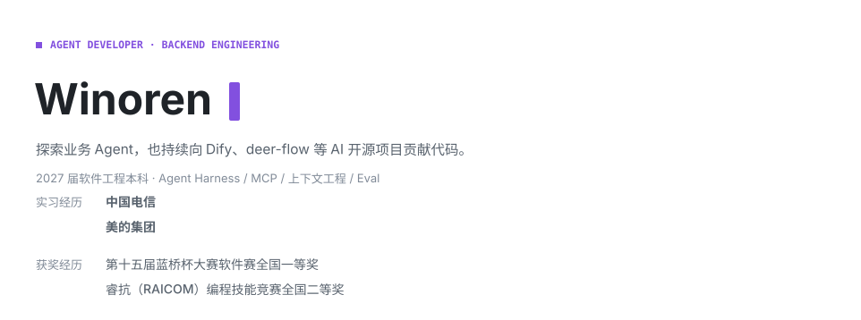
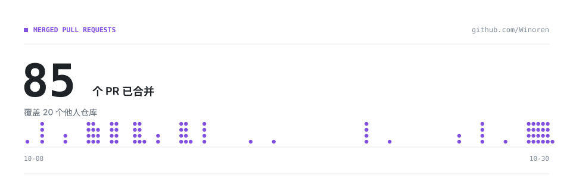
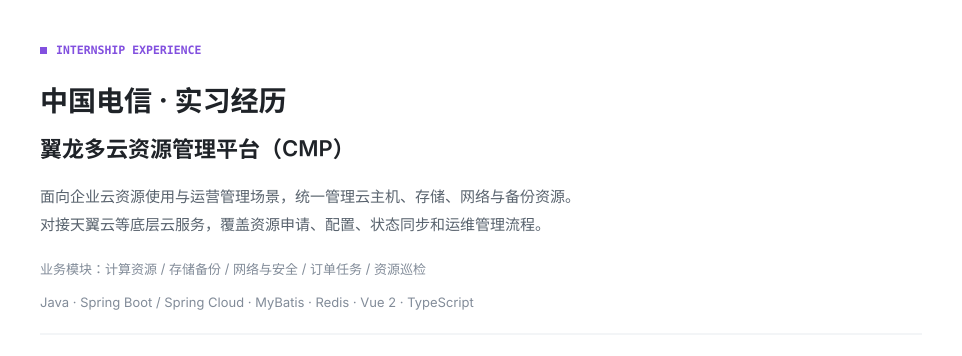

<picture>
  <source media="(prefers-color-scheme: dark)" srcset="./assets/hero-animated-dark.svg">
  
</picture>

<picture><source media="(prefers-color-scheme: dark)" srcset="./assets/merged-prs-header-dark.svg"></picture>

<picture><source media="(prefers-color-scheme: dark)" srcset="./assets/overview-row-01-name-dark.svg"></picture><a href="https://github.com/Winoren/Winoren/blob/main/CONTRIBUTIONS.md#pr-openclaw-openclaw" title="查看 openclaw/openclaw 的 PR 明细"><picture><source media="(prefers-color-scheme: dark)" srcset="./assets/overview-row-01-count-dark.svg"></picture></a><picture><source media="(prefers-color-scheme: dark)" srcset="./assets/overview-row-01-stars-dark.svg"></picture>

<picture><source media="(prefers-color-scheme: dark)" srcset="./assets/overview-row-02-name-dark.svg"></picture><a href="https://github.com/Winoren/Winoren/blob/main/CONTRIBUTIONS.md#pr-langgenius-dify" title="查看 langgenius/dify 的 PR 明细"><picture><source media="(prefers-color-scheme: dark)" srcset="./assets/overview-row-02-count-dark.svg"></picture></a><picture><source media="(prefers-color-scheme: dark)" srcset="./assets/overview-row-02-stars-dark.svg"></picture>

<picture><source media="(prefers-color-scheme: dark)" srcset="./assets/overview-row-03-name-dark.svg"></picture><a href="https://github.com/Winoren/Winoren/blob/main/CONTRIBUTIONS.md#pr-bytedance-deer-flow" title="查看 bytedance/deer-flow 的 PR 明细"><picture><source media="(prefers-color-scheme: dark)" srcset="./assets/overview-row-03-count-dark.svg"></picture></a><picture><source media="(prefers-color-scheme: dark)" srcset="./assets/overview-row-03-stars-dark.svg"></picture>

<picture><source media="(prefers-color-scheme: dark)" srcset="./assets/overview-row-04-name-dark.svg"></picture><a href="https://github.com/Winoren/Winoren/blob/main/CONTRIBUTIONS.md#pr-berriai-litellm" title="查看 BerriAI/litellm 的 PR 明细"><picture><source media="(prefers-color-scheme: dark)" srcset="./assets/overview-row-04-count-dark.svg"></picture></a><picture><source media="(prefers-color-scheme: dark)" srcset="./assets/overview-row-04-stars-dark.svg"></picture>

<picture><source media="(prefers-color-scheme: dark)" srcset="./assets/overview-row-05-name-dark.svg"></picture><a href="https://github.com/Winoren/Winoren/blob/main/CONTRIBUTIONS.md#pr-crewaiinc-crewai" title="查看 crewAIInc/crewAI 的 PR 明细"><picture><source media="(prefers-color-scheme: dark)" srcset="./assets/overview-row-05-count-dark.svg"></picture></a><picture><source media="(prefers-color-scheme: dark)" srcset="./assets/overview-row-05-stars-dark.svg"></picture>

<picture><source media="(prefers-color-scheme: dark)" srcset="./assets/overview-row-06-name-dark.svg"></picture><a href="https://github.com/Winoren/Winoren/blob/main/CONTRIBUTIONS.md#pr-tencent-weknora" title="查看 Tencent/WeKnora 的 PR 明细"><picture><source media="(prefers-color-scheme: dark)" srcset="./assets/overview-row-06-count-dark.svg"></picture></a><picture><source media="(prefers-color-scheme: dark)" srcset="./assets/overview-row-06-stars-dark.svg"></picture>

<picture><source media="(prefers-color-scheme: dark)" srcset="./assets/overview-row-07-name-dark.svg"></picture><a href="https://github.com/Winoren/Winoren/blob/main/CONTRIBUTIONS.md#pr-labring-fastgpt" title="查看 labring/FastGPT 的 PR 明细"><picture><source media="(prefers-color-scheme: dark)" srcset="./assets/overview-row-07-count-dark.svg"></picture></a><picture><source media="(prefers-color-scheme: dark)" srcset="./assets/overview-row-07-stars-dark.svg"></picture>

<picture><source media="(prefers-color-scheme: dark)" srcset="./assets/overview-row-08-name-dark.svg"></picture><a href="https://github.com/Winoren/Winoren/blob/main/CONTRIBUTIONS.md#pr-microsoft-semantic-kernel" title="查看 microsoft/semantic-kernel 的 PR 明细"><picture><source media="(prefers-color-scheme: dark)" srcset="./assets/overview-row-08-count-dark.svg"></picture></a><picture><source media="(prefers-color-scheme: dark)" srcset="./assets/overview-row-08-stars-dark.svg"></picture>

[查看 PR 明细](./CONTRIBUTIONS.md) · [邮件联系](mailto:d2572973337@qq.com)

<picture>
  <source media="(prefers-color-scheme: dark)" srcset="./assets/internship-telecom-dark.svg">
  
</picture>

<picture>
  <source media="(prefers-color-scheme: dark)" srcset="./assets/internship-midea-overview-dark.svg">
  
</picture>

<picture>
  <source media="(prefers-color-scheme: dark)" srcset="https://raw.githubusercontent.com/Winoren/Winoren/output/github-contribution-grid-snake-dark.svg">
  
</picture>
